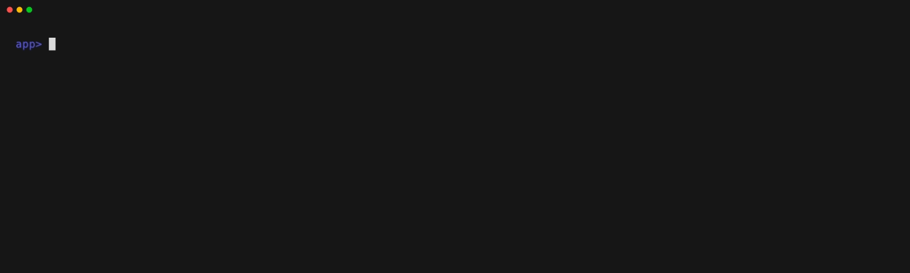
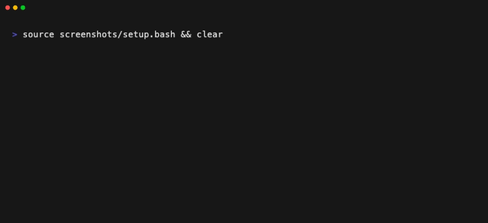
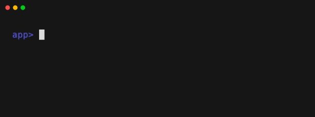

# ww

A pool of [jj](https://jj-vcs.github.io/jj/) workspaces, so many agents (or
builds, or people) can work in one repo at once without trampling each other.

    go install monks.co/ww@latest

